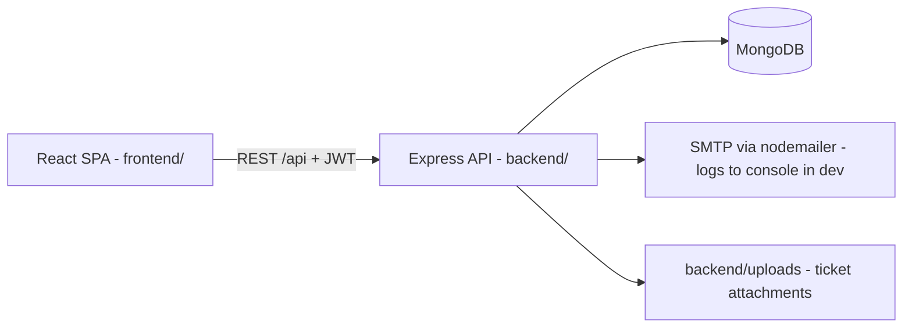

# Customer Portal — MERN (JavaScript)

Self-service portal where business customers view orders & invoices (PDF download), raise support tickets, and search a knowledge base. Support agents work a ticket queue; admins manage users and content.

**Business goal:** fewer support calls (KB deflection), faster ticket resolution, higher customer satisfaction.

## Tech stack

| Layer | Choice |
|---|---|
| Frontend | React 18, Vite, React Router 6, TanStack Query 5, axios, react-hook-form + zod, Tailwind CSS 3 + shadcn-style UI components (JS) |
| Backend | Node 22, Express 4 (CommonJS), Mongoose 8, zod, jsonwebtoken, bcryptjs, helmet, cors, cookie-parser, express-rate-limit, express-mongo-sanitize, pino, multer, pdfkit, nodemailer |
| Database | MongoDB 7 (Docker), schema migrations via `migrate-mongo` |
| Dummy data | `@faker-js/faker` with fixed seed (42) |
| Tests | Backend: Jest + supertest + mongodb-memory-server. Frontend: Vitest + React Testing Library |

## Architecture



- Roles: `customer`, `agent`, `admin`.
- Auth: access token (15 min, kept in memory on frontend) + refresh token (7 days, httpOnly cookie, rotated on every refresh, stored hashed in DB).
- **Tenant isolation:** every customer-facing query is scoped by `req.user.customerId` in the service layer. Customers get 404 for other customers' records.
- Orders/invoices/customers come from the dummy-data seed (an external ERP ingest webhook is out of scope for now).

## Folder structure

```
/
├─ package.json            # npm workspaces: frontend, backend
├─ docker-compose.yml      # mongo:7
├─ .env.example
├─ claude.md
├─ frontend/
│  ├─ index.html, vite.config.js, tailwind.config.js, postcss.config.js
│  └─ src/
│     ├─ app/              # App.jsx (router), providers, layouts/
│     ├─ components/ui/    # Button, Card, Input, Badge, Table, ...
│     ├─ features/
│     │  ├─ auth/          # AuthContext, LoginPage
│     │  ├─ dashboard/
│     │  ├─ orders/
│     │  ├─ invoices/
│     │  ├─ tickets/
│     │  ├─ kb/
│     │  └─ admin/
│     ├─ lib/              # api.js (axios + refresh), queryClient.js, utils.js
│     ├─ routes/           # ProtectedRoute.jsx
│     └─ main.jsx, index.css
└─ backend/
   ├─ migrate-mongo-config.js
   ├─ migrations/          # schema validators, indexes, counters
   ├─ uploads/             # gitignored
   ├─ tests/
   └─ src/
      ├─ config/           # env.js (zod-validated), db.js, logger.js
      ├─ middleware/       # auth, requireRole, validate, errorHandler, rateLimit, upload
      ├─ modules/<name>/   # <name>.model.js, .routes.js, .controller.js, .service.js, .schemas.js
      │                    # auth, users, customers, orders, invoices, tickets, kb, audit, metrics
      ├─ seed/             # index.js + generators/ + data/
      ├─ utils/            # AppError.js, asyncHandler.js, pagination.js, pdf.js, mailer.js
      ├─ app.js            # express app (no listen) — imported by tests
      └─ server.js         # connects DB + listens
```

## Data model

| Collection | Key fields | Indexes |
|---|---|---|
| users | email, passwordHash, name, role, customerId?, isActive, resetTokenHash?, resetTokenExp? | email unique |
| refreshtokens | userId, tokenHash, expiresAt | tokenHash unique, expiresAt TTL |
| customers | name, externalId, email, phone, address | externalId unique |
| orders | externalId, number, customerId, items[{sku,name,qty,unitPrice}], status, subtotal, tax, total, placedAt | externalId unique, {customerId, placedAt} |
| invoices | externalId, number, orderId, customerId, lines[], subtotal, tax, total, status (unpaid/paid/overdue), issuedAt, dueDate, paidAt? | externalId unique, {customerId, dueDate} |
| tickets | number, subject, customerId, createdBy, assignee?, status (open/pending/resolved/closed), priority (low/medium/high/urgent), category, orderId?, resolvedAt? | number unique, {status, assignee}, {customerId, createdAt} |
| ticketmessages | ticketId, authorId, body, internal, attachments[{filename, originalName, mimeType, size}] | {ticketId, createdAt} |
| kbcategories | name, slug, description | slug unique |
| kbarticles | title, slug, body (markdown), categoryId, status (draft/published), authorId, helpful, notHelpful, views | slug unique, text(title, body) |
| counters | _id (name), seq | — |
| auditlogs | actorId, action, entity, entityId, meta | {entity, entityId} |

## Migrations (`backend/migrations`, migrate-mongo)

1. `001-create-collections` — collections with `$jsonSchema` validators (validationLevel moderate).
2. `002-indexes` — unique + compound indexes above.
3. `003-kb-text-index` — text index on kbarticles.
4. `004-counters` — `ticketNumber`, `orderNumber`, `invoiceNumber` counters.

Every migration implements `up` and `down`. Migrations only define structure; data comes from the seed.

## Dummy data seed (`backend/src/seed`)

- `npm run seed` — seeds an empty DB. `npm run seed:reset` — wipes data collections then seeds. Refuses when `NODE_ENV=production`.
- Deterministic (faker seed 42). Volumes: 1 admin, 3 agents, 10 customer companies × 2 users, 120 orders, ~110 invoices (paid/unpaid/overdue), 40 tickets with 2–6 messages, 6 KB categories, 25 articles.
- Demo logins (dev only), password `Password123!`:
  - `admin@demo.local`
  - `agent1@demo.local` … `agent3@demo.local`
  - `customer1@demo.local` … `customer20@demo.local`

## API (`/api`)

| Area | Endpoints | Roles |
|---|---|---|
| Health | `GET /health` | public |
| Auth | `POST /auth/login`, `POST /auth/refresh`, `POST /auth/logout`, `GET /auth/me`, `POST /auth/forgot`, `POST /auth/reset` | public / authed |
| Users | `GET /users`, `POST /users`, `PATCH /users/:id` | admin |
| Users (assignee picker) | `GET /users/agents` | agent, admin |
| Customers | `GET /customers` | agent, admin |
| Orders | `GET /orders`, `GET /orders/:id` | all (customer scoped) |
| Invoices | `GET /invoices`, `GET /invoices/:id`, `GET /invoices/:id/pdf` | all (customer scoped) |
| Tickets | `GET /tickets`, `POST /tickets`, `GET /tickets/:id`, `PATCH /tickets/:id`, `POST /tickets/:id/messages` (multipart, `attachments`), `GET /tickets/:id/attachments/:filename` | all (customer scoped; internal notes & assignment = agent/admin) |
| KB | `GET /kb/categories`, `GET /kb/articles?q=&category=`, `GET /kb/articles/:slug`, `POST /kb/articles/:id/vote`, `POST /kb/articles`, `PATCH /kb/articles/:id`, `DELETE /kb/articles/:id` | read: all; write: agent, admin |
| Metrics | `GET /metrics/summary` | role-aware dashboard numbers |

List endpoints accept `page`, `limit` (max 100) and return `{ data, page, limit, total }`.
Errors return `{ error: { message, details? } }` with proper status codes.

## Conventions

- Backend: CommonJS, one folder per module; routes (thin inline handlers) → service (logic + tenant scoping via `utils/scope.js`) → model. A separate `.controller.js` only where handlers grow (auth).
- Indexes are owned by migrations; Mongoose `autoIndex` is on only in tests. Nullable refs are `$unset`, never stored as `null` (validators require objectId).
- Validate every request body/query with zod via `validate()` middleware. Never trust `customerId` from the client.
- Throw `AppError(status, message)`; `errorHandler` formats responses. Wrap async handlers with `asyncHandler`.
- Frontend: feature folders; server state only via TanStack Query; `api.js` handles 401 → refresh → retry once.
- KB markdown is rendered with `react-markdown` (no raw HTML).
- Secrets only in `.env` (never commit). Comments only for what code can't say.

## Commands

| Command | What it does |
|---|---|
| `npm run db` | local MongoDB without Docker (mongodb-memory-server, port 27018, data in `backend/.mongo-data`) — keep running |
| `docker compose up -d` | alternative: MongoDB via Docker on 27017 |
| copy `.env.example` → `backend/.env` | backend config (validated by `src/config/env.js`) |
| `npm install` | install all workspaces |
| `npm run migrate:up` / `npm run migrate:down` | apply / roll back migrations |
| `npm run seed` / `npm run seed:reset` | load dummy data |
| `npm run dev` | backend (4100) + frontend (5180, proxies `/api`) |
| `API_URL=http://localhost:4100` | env var to point the Vite proxy at a backend on another port |
| `npm test` | backend + frontend tests |
| `npm run build` | build frontend |

## Implementation plan

1. **Foundation** — workspaces, Docker, env, backend skeleton (config, logger, errors, security middleware, `/api/health`), migrations, frontend skeleton (Vite, Tailwind, router, layouts, api client).
2. **Auth & roles** — login/refresh/logout/me/forgot/reset, `auth` + `requireRole`, admin user management, frontend AuthContext + ProtectedRoute.
3. **Dummy-data seed** — generators for users, customers, orders, invoices, tickets, KB.
4. **Orders & invoices** — filtered/paginated lists, detail pages, invoice PDF (pdfkit).
5. **Tickets** — create (with KB suggestions while typing subject), threads, attachments (5 MB, png/jpg/pdf), agent queue, assignment, status flow, internal notes, email notifications.
6. **Knowledge base** — search, categories, article page, helpful votes, agent/admin editor.
7. **Dashboards** — customer home, agent queue stats, admin metrics (open tickets, avg resolution hours, KB deflection, overdue invoices).
8. **Hardening** — tests (auth, tenant isolation, tickets), rate limits, audit log.

## Verification checklist

- `npm run migrate:up` then `npm run migrate:down` run cleanly.
- `npm run seed:reset` twice → same counts.
- Customer A gets 404 on customer B's order/invoice/ticket (covered by tests).
- `npm test` and `npm run build` pass.
- Manual: login as customer → see orders, download invoice PDF, create ticket → login as agent → reply → customer sees reply.

## Out of scope (later)

Online payments, real-time chat, i18n, S3 storage, external ERP/Shopify ingest webhook.
